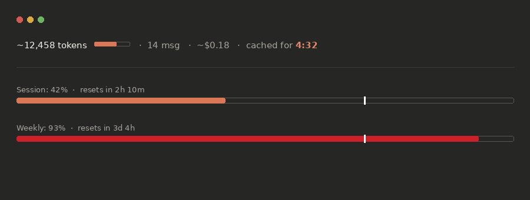

<div align="center">
  
  <h1>Tokka</h1>
  <p>A minimal browser extension that shows token count, cost, cache timer, and usage bars on claude.ai. Claude only, plus a library of Claude plugins and skills.</p>
  <p><sub>Developed and maintained by <strong>NullTrace</strong></sub></p>
</div>



*(Illustrative preview of the claude.ai HUD — actual numbers depend on your conversation and plan.)*

## What you get

- Token count, message count, cache timer and cost estimate under the message box
- **Per-model pricing**: reads the model you picked (Opus, Sonnet, Haiku) and prices the chat to match
- **Burn-rate prediction**: "limit in ~40m" when your current pace would hit 100% before the session resets
- **Usage history**: 24h session sparkline and a 7-day spend chart in the popup
- **Heavy-chat prompt**: past your warning threshold, one tap copies a handoff prompt so you can continue in a fresh chat
- **Calibration**: enter a real token count once and Tokka scales every estimate to match
- **Library tab**: your Claude plugins and skills with copy-paste install commands


Token count, message count, cost estimate, cache timer, and native session/weekly usage bars, right under the message box on claude.ai. Nothing runs anywhere else.

## Library

The popup's Library tab lists plugins and skills from `library/library.json`. Each entry has install steps with a Copy button. To add your own, append an object with `id`, `name`, `kind`, `tagline`, `tags`, `repo` and `steps`, then reload the extension.

Bundled:

| Plugin | Install (Claude Code) |
|---|---|
| [Tauri Audit](https://github.com/Wooinxlkz/Tauri-audit-plugin) | `/plugin marketplace add Wooinxlkz/Tauri-audit-plugin` then `/plugin install tauri-audit@tauri-audit` |
| [Arabic Formal Writer](https://github.com/Wooinxlkz/arabic-formal-writer) | `/plugin marketplace add Wooinxlkz/arabic-formal-writer` then `/plugin install arabic-formal-writer@arabic-formal-writer-marketplace` |

## Browser support

Tokka is a standard Manifest V3 extension and the same package works, unmodified, across:

- **Chrome**, **Edge**, **Brave**, **Arc** — all Chromium-based, install the same way
- **Firefox** (142+) — via `about:debugging` (temporary) or a signed `.xpi`

There's only one build — no separate downloads per browser.

## Installation

### Chrome / Edge / Brave / Arc

1. Download the latest release zip (or clone this repo)
2. Go to `chrome://extensions` (Edge: `edge://extensions`, Brave: `brave://extensions`, Arc: `chrome://extensions` works there too)
3. Enable **Developer mode** (top-right toggle)
4. Click **Load unpacked** and select the `tokka` folder — or drag-and-drop the zip onto the page
5. Open [claude.ai](https://claude.ai) — Tokka appears automatically

### Firefox

**Temporary install (for testing):**
1. Go to `about:debugging#/runtime/this-firefox`
2. Click **Load Temporary Add-on** and select `manifest.json` inside the `tokka` folder
3. Note: temporary add-ons are removed when Firefox restarts

**Permanent install:**
1. Build a signed `.xpi` with [web-ext](https://github.com/mozilla/web-ext) (`web-ext build` then `web-ext sign`, or submit to [addons.mozilla.org](https://addons.mozilla.org))
2. Install the resulting `.xpi`

### Userscript (Tampermonkey / Violentmonkey)

The userscript is a lighter standalone build and does not include the v1.4 features (Library tab, per-model pricing, burn-rate prediction, history, heavy-chat prompt, calibration). Use the extension for those.

1. Install a userscript manager if you don't have one
2. Open [`userscript/tokka.user.js`](./userscript/tokka.user.js) and install it
3. Visit claude.ai — the header and usage bars will appear

> The userscript build covers claude.ai only (core counter/timer/usage-bar functionality, no settings popup). The multi-site widget and settings popup are extension-only, since userscripts don't have a toolbar popup or manifest-based multi-host injection in the same way.

## Using it

Look right under the message box on any conversation:

- **Top line** — token count, mini progress bar, message count, cost estimate, and cache timer (whichever you've enabled)
- **Bottom line** — Session and Weekly usage bars. Click either one to force a refresh.

The popup also shows a running **Today / This week** estimated spend total across all your claude.ai conversations, tracked locally.

### Alerts

- **Toolbar badge** shows a live % right on the extension icon — session % — turning red past your warning threshold. This needs a small background service worker, since content scripts can't set the badge directly.
- **Near-limit pulse** briefly flashes a bar the instant it crosses your warning threshold, so you notice without staring at it. Fires once per crossing.

### Settings

Click the Tokka icon in your browser toolbar. The popup has three tabs: **Usage** (spend, session pace, 24h sparkline, 7-day chart, last chat), **Library** (plugins and skills) and **Settings**:

| Section | Setting | What it does | Default |
|---|---|---|---|
| Display | Message count | Adds `· N msg` next to the token count | On |
| Display | Compact mode | Shorter labels, tighter spacing | Off |
| Cost | Cost estimate | Adds `· ~$X.XX` using the pricing table you pick  | Off |
| Cost | Pricing | Auto reads the model you picked, or force Opus / Sonnet / Haiku list pricing | Auto |
| Cost | Context window | Scale of the context bar: 200k or 1M | 200k |
| Cost | Spend tracking | Keeps the Today/Week totals shown at the top of the popup | On |
| Calibration | Count multiplier | Enter the real token count for your last chat and Tokka scales all estimates to match (0.5x to 2x) | 1.00x |
| Alerts | Warning threshold | % at which bars turn red | 90% |
| Alerts | Heavy chat prompt | Past the threshold, offers a copyable handoff prompt for a fresh chat | On |
| Alerts | Near-limit pulse | Brief flash when a bar crosses the threshold | On |
| Alerts | Toolbar badge | Live % on the extension icon | On |

The cost estimate and spend tracker are both **rough approximations** — they don't account for prompt caching discounts, system prompt tokens, or tool-call overhead beyond what's in the visible conversation. Always check the [Claude Console](https://console.anthropic.com) for real billing.

## How it works

- Intercepts Claude's own API responses to read conversation data and usage info
- Uses a vendored tokenizer (`o200k_base`, OpenAI's public tokenizer) as a stand-in for approximate counting. Anthropic doesn't publish Claude's tokenizer, so counts are a close estimate, never exact
- Reads Claude's `/usage` endpoint plus live SSE `message_limit` data — the SSE gives exact, unrounded utilization fractions, so the bars are more accurate than the rounded percentages on Claude's native `/usage` page
- Watches for DOM changes to (re)inject UI elements as you navigate between chats

Settings (toggles, thresholds, pricing model) are stored locally via `chrome.storage.local` — nothing leaves your browser.

## Privacy

- All data stays local — no external servers, no telemetry, no analytics
- On claude.ai: reads your `lastActiveOrg` cookie to query Claude's own `/usage` endpoint; requests only ever go to `claude.ai`
- Settings, spend totals, your last chat's token count and a 72-hour log of usage percentages are stored locally in your browser via the standard extension storage API. None of it is sent anywhere

## Limitations

Being upfront about what Tokka can't do, rather than faking it:

- **Claude Code is not trackable.** It's a CLI/desktop tool, not a web page - a browser extension has no way to see it at all.
- **Cowork is not currently tracked.** It's a separate desktop app; we don't have confirmation it ever runs inside a claude.ai browser tab.
- **No plan/tier detection.** We couldn't confirm a tier field exists in the data Tokka reads, so it doesn't guess.
- **Token counts are estimates.** The tokenizer isn't Claude's own, and system prompt, tools and hidden thinking aren't included.

See [CHANGELOG.md](./CHANGELOG.md) for the full reasoning behind each of these.

## Project structure

```
tokka/
├── manifest.json           Extension manifest (MV3)
├── popup/                  Toolbar settings popup
├── src/
│   ├── background/
│   │   └── service-worker.js Sets the toolbar badge per-tab (content scripts can't do this directly)
│   ├── content/
│   │   ├── constants.js      Shared colors, pricing table, config
│   │   ├── settings.js       Settings load/save/sync (chrome.storage.local)
│   │   ├── alerts.js         Shared near-limit pulse + badge-messaging helpers
│   │   ├── spend-tracker.js  Local daily/weekly $ tally
│   │   ├── heavy-chat.js     One-time "chat is heavy" prompt with handoff copy

│   │   ├── tokens.js         claude.ai conversation → token/message metrics
│   │   ├── ui.js             claude.ai header + usage bar UI
│   │   ├── main.js           claude.ai entry point
│   │   └── bridge-client.js  claude.ai page-bridge message relay
│   ├── shared/
│   │   └── burn.js           Burn-rate prediction + usage log (content script and popup)
│   ├── injected/            Page-context bridge (reads Claude's API responses)
│   ├── vendor/               Vendored o200k_base tokenizer
│   └── styles.css
├── library/
│   └── library.json         Plugins and skills shown in the Library tab
├── popup/                   Popup UI (Usage / Library / Settings)
├── userscript/              Standalone userscript build 
└── icons/
```

## Credits

- Forked and rebranded from [**Claude Counter**](https://github.com/she-llac/claude-counter) by she-llac (MIT) — all core token-counting, cache-timer, and usage-bar logic for claude.ai originates there
- Token estimation via [gpt-tokenizer](https://github.com/niieani/gpt-tokenizer) (MIT)
- Originally inspired by [Claude Usage Tracker](https://github.com/lugia19/Claude-Usage-Extension) by lugia19

Tokka is an independent project and is not affiliated with or endorsed by Anthropic.

## License

MIT — see [LICENSE](./LICENSE).
